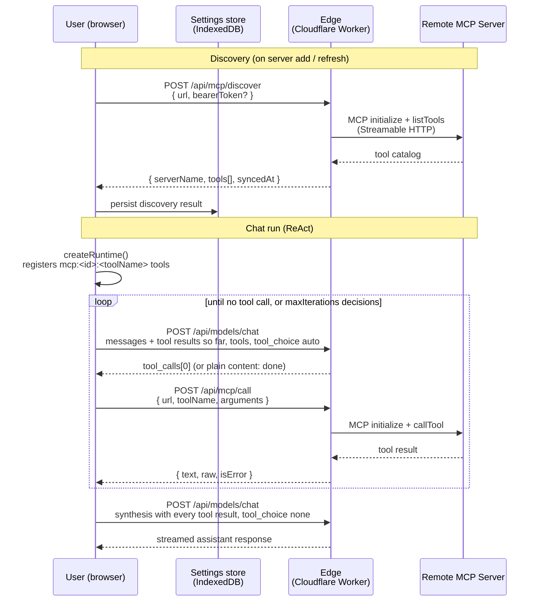
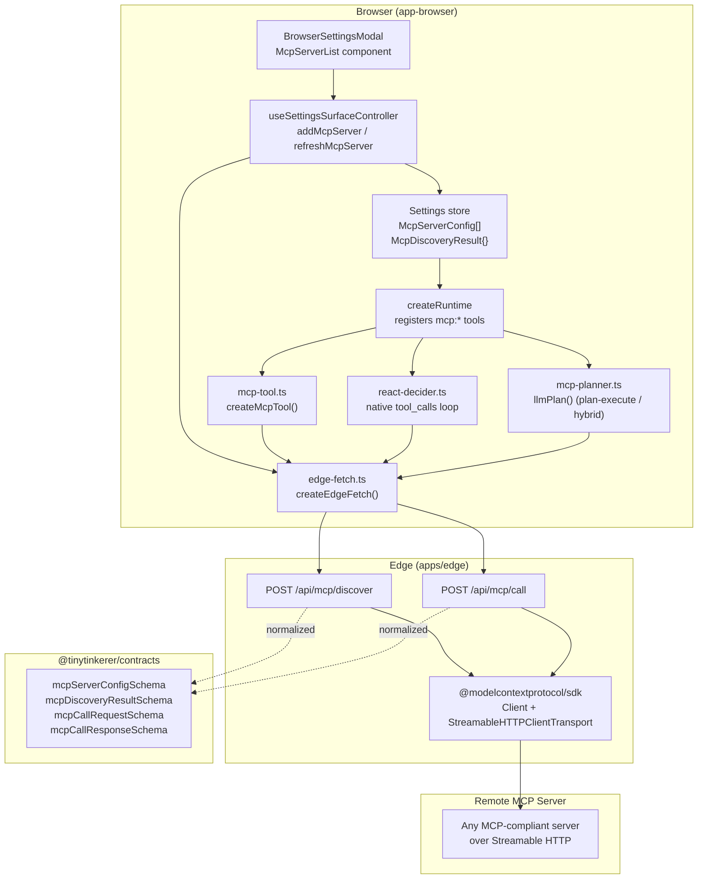

# MCP Integration

TinyTinkerer supports [Model Context Protocol](https://modelcontextprotocol.io/) (MCP) servers. Users add remote MCP servers in Settings, the frontend discovers their tools, and those tools become available to the assistant during chat. An embedding app can also provide servers of its own to every user; see [Host-provided servers](#host-provided-servers).

Only V1 scope is implemented: tool calling over Streamable HTTP. Resources, prompts, remote OAuth, SSE fallback, and stdio servers are out of scope.

See also:

- [ARCHITECTURE.md](../architecture/ARCHITECTURE.md)
- [packages-concept.md](../architecture/packages-concept.md)

---

## How It Works

### 1 — User registers a server

In the Settings modal (or widget inline settings), the user enters a name, URL, and an optional Bearer token. The frontend stores this in the user's local IndexedDB preferences.

### 2 — Discovery

When a server is added (or manually refreshed), the browser calls `POST /api/mcp/discover` on the edge. The edge opens a Streamable HTTP MCP connection to the remote server, runs `initialize` → `listTools`, and returns a normalized tool catalog. The catalog is stored alongside the server config in preferences.

### 3 — Tool registration

When a chat run starts, `createRuntime` reads the current MCP server configs and their cached discovery results. Every tool from every enabled server with a successful discovery is registered into the `ToolRegistry` with the id format `mcp:<serverId>:<toolName>`.

Before the edge call, `createMcpTool` runs the model's arguments through a **local triage** validator compiled from the tool's discovered JSON Schema (`mcp-schema.ts`). This is a partial, **fail-open** check — a first line of defence, **not** a full JSON-Schema validator and **not** a substitute for the remote server's own validation:

- **Enforced:** required-ness (`required`), primitive `type`s (`string` / `number` / `integer` / `boolean`), `enum` membership, and nested object/array **shape** (`properties`, `items`). A wrong-typed or missing-required argument fails locally, where the agent can correct it, instead of as an opaque remote error.
- **NOT enforced (passes through silently):** numeric/string refinements (`minimum`/`maximum`/`pattern`/`format`/`minLength`…), schema composition (`$ref`/`definitions`, `oneOf`/`anyOf`/`allOf`), and `const`. Any construct the compiler can't model — or a non-object top-level schema — falls back to a permissive record, so a valid-but-exotic call is **never rejected**.

Because the gap is invisible at the call site, treat this as triage only: **keep the remote server's validation and the tool's own error handling** — do not remove them on the strength of this local check.

### 4 — The tool-calling loop

MCP tools are ordinary entries in the run's `ToolRegistry`, next to plugin tools and the host app's own tools. Every agent strategy sees the same registry, so they all get MCP tools the same way.

The default agent is **ReAct** (`agentType: 'react'`). It runs the native tool-calling loop:

1. The browser sends `/api/models/chat` the conversation so far, with every registered tool advertised as a native function (`tool_choice: 'auto'`). Tool ids are sanitized into wire names, so `mcp:kiprint:add_wires` is advertised as `mcp_kiprint_add_wires`.
2. The model answers with one `tool_calls` entry, or with plain content once it has enough.
3. The runtime runs that tool and appends the call and its result to the conversation as an `assistant` `tool_calls` message plus a `tool` result message.
4. The next decision sees every earlier result, so it can use a value one call returned (a `projectId`, a reported fault) as an argument to the next.

The loop repeats until the model stops calling tools or the turn reaches its **step bound**.

#### Step bound

`maxIterations` bounds the decisions in one turn. It defaults to **16** (`DEFAULT_MAX_ITERATIONS` in agent-core). Every decision counts, including the closing one with no tool call. So a default turn makes at most 16 tool calls, or 15 when the model ends the turn with its own closing decision. When the bound is reached, the runtime stops calling tools and answers from the results it has. A value below 1 is raised to 1, and a non-finite value falls back to the default.

A host sets its own bound with `createBrowserApp(config, { …, maxIterations })`. The bound applies to all tools alike.

An iterative MCP workflow fits in one turn. For example, KiPrint's: `create_project` → `add_components` → `add_wires` → `check_project` → `remove_items` → `add_wires` → `check_project` → `plan_guide` → `export_project` → `get_project`. That is ten calls, each chosen after reading the result of the one before. `packages/app/app-browser/tests/mcp-multi-step.test.ts` runs exactly this sequence against a stateful mock MCP server.

#### Other agent types

Users can switch the agent type in Settings:

- **Plan-then-Execute** (`plan-execute`) asks the model once for a JSON `ExecutionPlan` (`mcp-planner.ts`), then runs its steps in order. Arguments are fixed when the plan is made, so a step cannot use an earlier step's result. Plans are capped at `maxIterations` steps. If the planner request fails in transport, the browser falls back to the keyword-based `inferPlan` heuristic.
- **Hybrid** (`hybrid`) makes a plan, then runs each plan step as a short ReAct sub-loop of up to 3 decisions. If a step gets stuck, it replans once. The total across all sub-loops is capped at `maxIterations`.

Use ReAct for iterative MCP work.

### 5 — Tool call

When the model calls an MCP tool, `createMcpTool`'s `execute` function calls `POST /api/mcp/call` on the edge. The edge opens a fresh MCP connection, calls the named tool, and returns a normalized result. The result goes back to the model unmodified as the `tool` message, and the loop continues.

A failed call becomes an observation as well. The model sees the error and can correct its arguments on the next step.

### 6 — Synthesis

Once the loop ends, the assistant composes its answer from the whole conversation, including every tool call and result, with tool calls disabled (`tool_choice: 'none'`).

---

## Architecture



### Package responsibilities



---

## Data model

### McpServerConfig

Stored in IndexedDB under the preference key `settings_mcp_servers` as a JSON array.

```ts
type McpServerConfig = {
  id: string // crypto.randomUUID() assigned on add
  name: string
  url: string // must be https:// or http://localhost / 127.0.0.1
  bearerToken?: string // forwarded to the remote server, never logged
  enabled: boolean
}
```

### McpDiscoveryResult

Stored under `settings_mcp_discovery` as a JSON object keyed by `serverId`. Cleared automatically when `url` or `bearerToken` changes.

```ts
type McpDiscoveryResult = {
  serverId: string
  serverName: string
  tools: McpToolMeta[]
  syncedAt: string // ISO timestamp
  error?: string // set when last sync failed; server contributes no tools
}

type McpToolMeta = {
  toolName: string
  description: string
  inputSchema: Record<string, unknown> // raw JSON Schema from the MCP server
}
```

---

## Edge proxy

Both MCP routes require the same `Authorization` header that `/api/search` and `/api/models/chat` require. They are stateless: each request opens a fresh Streamable HTTP transport and MCP client connection, and closes it in a `finally` block. A server must not rely on an `Mcp-Session-Id` surviving from one request to the next.

### URL validation

```
https://          → allowed everywhere
http://localhost  → allowed (local development)
http://127.0.0.1  → allowed (local development)
anything else     → rejected with HTTP 400
```

Private IP ranges, `file://`, and non-HTTP schemes are all blocked.

Two edge settings refine this:

- `MCP_ALLOWED_HOSTS` (var), when set, replaces the private-address blocklist with a strict allowlist: only the listed hostnames pass.
- `MCP_HOST_SERVERS` (var) lists the hostnames of [host-provided servers](#host-provided-servers). These are always reachable, even when `MCP_ALLOWED_HOSTS` is set. The scheme rules above still apply to them.

### Discover — `POST /api/mcp/discover`

Request body: `{ url: string, bearerToken?: string }`

The edge connects to the MCP server, calls `listTools`, and returns:

```json
{
  "serverId": "",
  "serverName": "My Weather Server",
  "tools": [
    {
      "toolName": "get_current_weather",
      "description": "Returns current weather for a location.",
      "inputSchema": {
        "type": "object",
        "properties": { "location": { "type": "string" } },
        "required": ["location"]
      }
    }
  ],
  "syncedAt": "2025-05-28T10:00:00.000Z"
}
```

The `serverId` field in the response is empty — the browser fills it with the local UUID before persisting.

### Call — `POST /api/mcp/call`

Request body: `{ url, bearerToken?, toolName, arguments }`

```json
{
  "serverName": "My Weather Server",
  "toolName": "get_current_weather",
  "text": "Clear sky, 22°C in Berlin.",
  "raw": { "content": [{ "type": "text", "text": "Clear sky, 22°C in Berlin." }] },
  "isError": false
}
```

---

## Example: adding a weather MCP server

Suppose you have a Streamable HTTP MCP server at `https://mcp.example.com/weather` that exposes a `get_current_weather` tool.

### In the Settings modal

1. Open Settings → scroll to **MCP Servers**.
2. Click **+ Add server**.
3. Fill in:
   - **Name**: My Weather Server
   - **URL**: `https://mcp.example.com/weather`
   - **Bearer token**: _(your API key, if required)_
4. Click **Add** — discovery runs automatically. The card shows `1 tool` once it completes.

### What the assistant can now do

Ask: _"What's the weather in Berlin right now?"_

The model sees `get_current_weather` among the advertised functions and answers with a native tool call:

```json
{
  "tool_calls": [
    {
      "id": "call_1",
      "type": "function",
      "function": {
        "name": "mcp_<serverId>_get_current_weather",
        "arguments": "{\"location\":\"Berlin\"}"
      }
    }
  ]
}
```

The call goes through the edge proxy to the remote MCP server. The result goes back to the model, which can call another tool or stop. The answer is then synthesized from every result.

### What the turn activity panel shows

The call appears in the chat page's turn activity panel like any other tool call:

```
▶  [My Weather Server] get_current_weather
   Output: Clear sky, 22°C in Berlin.
```

MCP presentation is owned by `summarizeMcpActivity` (`packages/app/app-browser/src/runtime/mcp-tool.ts`): it maps the result to the generic `ActivityView` — the host-resolved `[server] tool` title, `ok`/`error` status, and the full text content (no truncation) as an `Output` (or `Error`) section. Web search and every other tool flow through the same generic activity renderer (`turn-activity-panel.tsx`); there is no MCP-specific UI beyond this summarizer.

---

## Host-provided servers

An app that embeds TinyTinkerer can provide MCP servers to every user. For example, CanFactory gives its assistant a KiPrint server. These servers:

- need no Settings change;
- cannot be edited or removed by the user;
- never put a token in the browser.

### In the app

Pass the servers to `createBrowserApp`. There is no token field:

```ts
import { createBrowserApp } from '@nntin/tinytinkerer-embed'

const app = createBrowserApp(config, {
  plugins,
  mcpServers: [{ id: 'kiprint', name: 'KiPrint', url: 'https://kiprint.nntin.xyz/mcp' }]
})
```

- **Ids:** an `id` must be unique and contain no `:`. `createBrowserApp` throws otherwise.
- **Discovery:** `initializeBrowserApp` discovers each server at boot with the signed-in user's token. It discovers again whenever the token changes (sign-in, sign-out, account switch). While signed out it sends nothing, because the MCP routes need a signed-in caller.
- **Registration:** discovered tools register like a user's, as `mcp:<id>:<toolName>`, and run in the same [tool-calling loop](#4--the-tool-calling-loop). Host servers are registered before the user's own, so on an id clash the app's server wins.
- **Storage:** the servers and their discovery results live in memory (`app.stores.hostMcp`). They are never written to the user's preferences.
- **Settings:** Settings lists host servers above the user's own, marked "Provided by this app", with their sync status and nothing to toggle, edit or remove.

### On the edge

The browser calls `/api/mcp/discover` and `/api/mcp/call` with the server's `url` and no `bearerToken`. The edge recognises the host by its hostname:

| Setting                    | Effect                                                                                                                                                                |
| -------------------------- | --------------------------------------------------------------------------------------------------------------------------------------------------------------------- |
| `MCP_HOST_SERVERS` (var)   | Comma-separated hostnames. Always reachable, even when `MCP_ALLOWED_HOSTS` is set. The only hosts eligible for token injection.                                       |
| `MCP_HOST_TOKENS` (secret) | JSON object, hostname → bearer token, e.g. `{"kiprint.nntin.xyz":"<token>"}`. For a host server the edge drops any browser-supplied `bearerToken` and sends this one. |

A hostname that appears in `MCP_HOST_TOKENS` but not in `MCP_HOST_SERVERS` never gets a token. A host server with no token entry is called without one.

Users' own servers are unaffected. They follow `MCP_ALLOWED_HOSTS` (or the blocklist) and send their own `bearerToken`, exactly as before.

The tinytinkerer deployments set `MCP_HOST_SERVERS=kiprint.nntin.xyz` on the production edge and `kiprint-preview.nntin.xyz` on the develop edge. See [Vercel deployment](../self-hosting/vercel-deployment.md#host-provided-mcp-servers) for setting the secret.

### Results and links

Tool results pass through the edge unmodified. KiPrint's `export_project`, for example, returns a signed, expiring `https://<kiprint-host>/downloads/<token>` URL. The browser fetches that URL directly from KiPrint, not through the edge.

Whether that URL is clickable in an answer depends on the app's `appAssistantPolicy`:

- **No policy, or a policy without a link rule:** every `http(s)` link the model writes renders as a link. The markdown parser only strips non-web schemes such as `javascript:`. KiPrint's download URLs work as they are.
- **A policy that demotes links it cannot verify** (as the documentation assistant does in `prepareRenderedContent` and `finalizeAnswer`): authorize the host's URLs from the turn's results. Each `AppToolResultRecord` from a host server carries `source: { kind: 'mcp', groupId: '<server id>' }`, and its `output.text` is the server's text exactly as returned. A link is genuine if it appears verbatim in such a result and is on the server's host:

```ts
import type { AppToolResultRecord } from '@nntin/tinytinkerer-embed'

const KIPRINT_HOST = 'kiprint.nntin.xyz'

// The KiPrint URLs this turn's successful results actually returned.
const kiprintLinks = (results: readonly AppToolResultRecord[]): Set<string> =>
  new Set(
    results
      .filter((result) => result.source?.kind === 'mcp' && result.source.groupId === 'kiprint')
      .flatMap((result) => {
        const text = (result.output as { text?: unknown }).text
        return typeof text === 'string' ? (text.match(/https:\/\/[^\s"'<>)]+/g) ?? []) : []
      })
      .filter((url) => new URL(url).hostname === KIPRINT_HOST)
  )
```

Keep a link when its `url` is in this set, and demote it otherwise. Check against the results, not against the host alone: an answer could otherwise carry a fabricated KiPrint path.

---

## Building a compatible MCP server

Any server that implements the [MCP Streamable HTTP transport](https://modelcontextprotocol.io/specification/2025-06-18/basic/transports) is compatible. The edge uses the official `@modelcontextprotocol/sdk` `Client` + `StreamableHTTPClientTransport`.

Minimal requirements:

- Respond to the `initialize` request (MCP handshake)
- Respond to `tools/list` with a list of tool definitions including `name`, `description`, and `inputSchema`
- Respond to `tools/call` with a `content` array of `{ type: "text", text: "..." }` items

The server does not need to support resources, prompts, or sampling for V1 compatibility. Because the proxy is stateless, the server must also work without an `Mcp-Session-Id` carried between requests.

---

## Limitations (V1)

| Out of scope                 | Reason                                                                       |
| ---------------------------- | ---------------------------------------------------------------------------- |
| MCP Resources                | V1 targets tool calling only                                                 |
| MCP Prompts                  | V1 targets tool calling only                                                 |
| Remote OAuth for MCP servers | Users manage tokens manually via Bearer token field                          |
| SSE fallback transport       | Streamable HTTP is the standard remote transport                             |
| stdio servers                | Browser-to-local-process communication is not feasible without a local proxy |
| Parallel tool calls          | One tool call per step; a turn makes at most `maxIterations` of them         |
| Streaming tool results       | MCP call results are collected in full before being returned                 |
